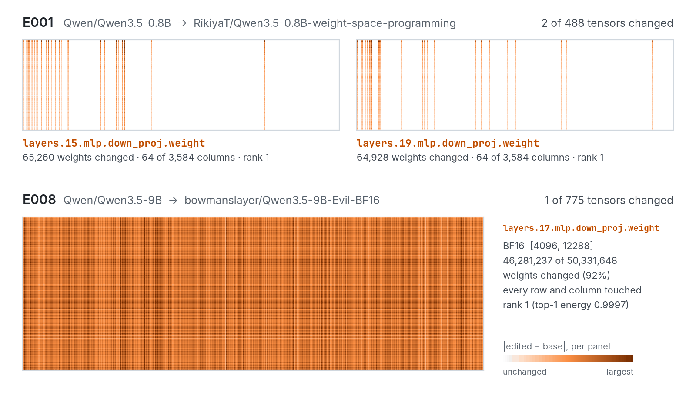
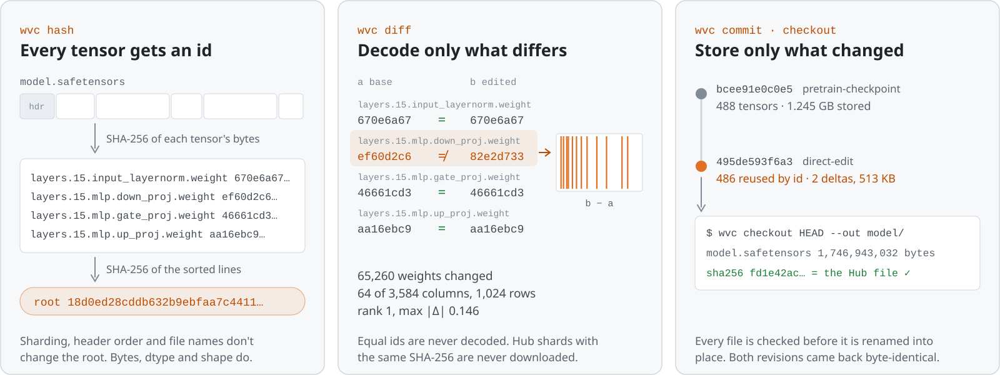

<p align="center">
  
</p>

<p align="center">
  <a href="#quick-start">Quick start</a> ·
  <a href="#what-it-found">What it found</a> ·
  <a href="#how-it-works">How it works</a> ·
  <a href="#commands">Commands</a> ·
  <a href="#status">Status</a> ·
  <a href="docs/spec-v0.md">Spec</a> ·
  <a href="experiments/">Receipts</a>
</p>

<p align="center">
  
  
  <a href="LICENSE"></a>
  <a href="https://github.com/evnsnclr/wvc/actions/workflows/ci.yml"></a>
</p>

**wvc is an experimental tool that treats a model checkpoint as a set of tensors, not one opaque file.** It gives every tensor an id (the SHA-256 of its bytes), shows exactly which tensors two checkpoints disagree on and how (elements, rows, columns, rank), and stores a new revision as deltas against its parent that check out byte for byte. It reads safetensors with numpy alone, needs no PyTorch or GPU, and can diff two Hugging Face Hub repositories while downloading only the shards that differ.

Open-weight models change through fine-tunes, merges, adapters, abliteration, and, [since November 2026](https://rikiyat.github.io/blog/weight-space-programming/), direct edits written by LLM agents. The Hub records each change as new files and a model card that names a parent with [one of four words](https://huggingface.co/docs/hub/model-cards). A card that says `finetune` doesn't say which weights moved, and safety, interpretability, and supply-chain work all need to know.

<p align="center">
  
</p>
<p align="center"><sub>The command and output of a real run, repeated on 2026-11-03 with output byte-identical to its <a href="experiments/README.md">receipt</a>. The animation compresses time: from the Hugging Face cache the run takes 15 to 40 s on an M4 Max; the first run also downloads the two shards that differ (10.67 GB).</sub></p>

## What it found

Two public weight changes and what `wvc diff` reports for them. The figure is drawn from the bytes of both checkpoints by [`make_deltas.py`](docs/assets/make_deltas.py), which first checks every count against the receipts.

<picture>
  <source media="(prefers-color-scheme: dark)" srcset="docs/assets/deltas-dark.png">
  
</picture>

| | An edit written by an LLM agent | An upload that names no tensor |
|---|---|---|
| **Pair** | `Qwen/Qwen3.5-0.8B` → `RikiyaT/Qwen3.5-0.8B-weight-space-programming` | `Qwen/Qwen3.5-9B` → `bowmanslayer/Qwen3.5-9B-Evil-BF16` |
| **The card says** | the two edited tensors and their hashes ([Weight-Space Programming](https://rikiyat.github.io/blog/weight-space-programming/)) | `finetune`, with no method and no tensor named |
| **wvc finds** | 2 of 488 tensors: 64 of 3,584 columns of `mlp.down_proj` in layers 15 and 19, rank 1 each | 1 of 775 tensors: layer 17's `mlp.down_proj`, 92% of its weights, rank 1 (top-1 energy 0.9997) |
| **Check** | changed counts and hashes equal the authors' own manifest | none beyond the bytes: no method was published |
| **Read** | one 1.7 GB file per side; the diff took 9.8 s on an M4 Max | 1 of 4 shards per side: 10.67 of the pair's 38.61 GB |

A diff shows where a model changed and how, not what the change does.

## Quick start

wvc is not on PyPI yet. Install it from a clone with [uv](https://docs.astral.sh/uv/) (Python 3.11 or newer):

```bash
git clone https://github.com/evnsnclr/wvc && cd wvc
uv sync --extra hf   # the hf extra reads Hub repositories; plain `uv sync` is enough for local files
```

Diff the two sub-kilobyte checkpoints that ship with the [spec's conformance vectors](spec/vectors/v0/README.md); nothing is downloaded:

```bash
uv run wvc diff --rank spec/vectors/v0/a.safetensors spec/vectors/v0/b.safetensors
```

```text
tensors: 4 (1 changed, 1 unchanged, 1 added, 1 removed, 0 reshaped)
elements changed: 4 of 32 (12.5000%)

status   tensor  dtype     shape    changed  rows  cols  max|d|  |d|/|a|  rank  top1
removed  h       F16       [2,2,2]  -        -     -     -       -        -     -
changed  w       F32       [4,6]    4/24     4     1     1       0.418    1     1.0000
added    x       None->I8  [3]      -        -     -     -       -        -     -
```

Then a real pair from the Hub (the first run downloads 1.7 GB per side into the Hugging Face cache):

```bash
uv run wvc diff --rank hf:Qwen/Qwen3.5-0.8B hf:RikiyaT/Qwen3.5-0.8B-weight-space-programming
```

Keep revisions in a repository and get the exact files back:

```bash
export WVC_AUTHOR="Your Name"   # commits never record an author silently
uv run wvc init demo
uv run wvc commit spec/vectors/v0/a.safetensors -m "base" --op pretrain-checkpoint --repo demo
uv run wvc commit spec/vectors/v0/b.safetensors -m "add 1.0 to column 2 of w" --op direct-edit --repo demo
uv run wvc log --repo demo
uv run wvc checkout HEAD --out restored --repo demo
```

<details>
<summary>What that prints</summary>

Commit ids include the time and the author, so yours will differ.

```text
initialised an empty wvc repository in /path/to/wvc/demo/.wvc
commit b44ff44ddbce97c02cad0786047c939e1d54f70c25ca5d0320d5dd16d5cc0956 (main, no parent)
tensors: 3 (0 reused by hash, 3 stored full, 0 stored as delta)
payload bytes written: 448 in 0.01 s
commit 8461fce5701f28ae37aafd431ec8d2cdfa372be949f78105139078f715f68216 (main, parent b44ff44ddbce)
tensors: 3 (1 reused by hash, 1 stored full, 1 stored as delta: 1 delta-xor-planes)
payload bytes written: 364 in 0.01 s
8461fce5701f  2026-11-03T17:43:19Z  direct-edit          3 tensors  add 1.0 to column 2 of w
b44ff44ddbce  2026-11-03T17:43:19Z  pretrain-checkpoint  3 tensors  base
checked out 8461fce5701f into restored: 1 file, 355 bytes in 0.00 s
b.safetensors  355 bytes  sha256 ok
manifest root 226839773eb209266cbb929481b4e106d483eec17361879692c0bd87789b15cc verified against the files
```

</details>

`diff` exits 1 when the checkpoints differ, like `diff(1)`; `verify` exits 0 only when every tensor and the root match; every wvc error exits 2. Add `--json` for a machine-readable record.

## How it works

<picture>
  <source media="(prefers-color-scheme: dark)" srcset="docs/assets/how-dark.svg">
  
</picture>

1. **Identity.** A tensor's id is the SHA-256 of its stored bytes; a manifest lists every tensor's name, dtype, shape, and id, and its root is a SHA-256 over those lines. Sharding, header order, and file names don't change the root ([spec §1](docs/spec-v0.md#1-tensor-identity-and-manifests-implemented)).
2. **Diff.** Tensors with equal ids are never decoded. The rest are decoded exactly (BF16, FP16, FP8, and the rest; a dtype that can't be decoded gets a byte-level count) and compared element by element: changed count, rows and columns touched, largest change, relative norm, and an SVD rank estimate. Across two Hub repositories, a shard whose name, size, and SHA-256 agree is skipped; its tensors are reported from its header, read by range request ([spec §5.5](docs/spec-v0.md#55-hub-checkpoints-implemented-2026-11-03)).
3. **Store.** `commit` keeps each tensor once by id and stores a changed tensor as an XOR-plane or sparse delta against its parent when that is smaller. It also records every file's header bytes and the non-tensor files a loader needs (config, tokenizer, chat template), so `checkout` rebuilds the original files and checks each one's SHA-256 before it appears ([spec §3](docs/spec-v0.md#3-repository-objects-and-deltas-implemented-2026-11-02)).

## Storage

Bytes needed to store a revision given its parent, as a share of its raw tensor bytes (smaller is better), on four public pairs:

| Revision pair | Compress each tensor (zstd) | Byte-chunk dedup, best case | wvc delta |
|---|---|---|---|
| Qwen3.5-0.8B → weight-space edit (sparse rank-1 edit, 1.75 GB) | 78.2% | 0.66% | 0.030% |
| Qwen2.5-0.5B + rank-8 merge (synthetic adapter merge, 988 MB) | 77.8% | 3.51% | 1.67% |
| pythia-160m, step 142k → 143k (consecutive pretraining checkpoints, 649 MB) | 58.0% | 58.0% | 33.6% |
| Qwen2.5-0.5B → Instruct (dense post-training fine-tune, 988 MB) | 77.9% | 77.9% | 56.3% |

Byte-level chunk dedup, fixed or content-defined, found nothing beyond whole-tensor identity on any of four public revision pairs: a fine-tune rewrites bytes in place, and a 64 KiB chunk can't see one changed element. Numeric deltas can. On the sparse edit a delta needs 22× fewer bytes than tensor dedup alone (0.53 MB against 11.5 MB), on the synthetic rank-8 merge 2.1× fewer, and on dense updates it saves a modest 21% to 27% beyond byte-grouped compression. In a wvc repository the LLM-written edit costs 513 KB on top of a 1.245 GB base, and both revisions check out hash-identical to the Hub's files.

## Commands

| Command | What it does |
|---|---|
| `wvc hash CKPT` | Print a manifest: every tensor's SHA-256 and a root. `--format gguf-hash` prints llama.cpp's `gguf-hash` lines instead. |
| `wvc diff A B` | Compare two checkpoints tensor by tensor. `--rank` estimates the rank of each change, `--all` lists unchanged tensors too. |
| `wvc verify CKPT MANIFEST` | Check a checkpoint against a manifest saved from `wvc hash`. |
| `wvc init`, `commit`, `log`, `show`, `checkout` | A local repository: tensors stored once by id, changes as deltas, files rebuilt byte for byte. |
| `wvc fsck` | Re-verify every payload, object, manifest, commit, and ref in a repository. |
| `wvc bisect GOOD BAD --test CMD` | Find the first commit where a behavioural test fails (`--sweep` tests every commit instead). |
| `wvc merge-adapter BASE ADAPTER` | Merge a PEFT LoRA adapter deterministically and store its targets as low-rank deltas. |
| `wvc remote`, `push`, `pull`, `clone` | Move commits between repositories: plain directories, or Hub repositories with the `hf` extra. |
| `wvc card REF` | Print model-card metadata that carries the manifest root. |

`CKPT` is a `.safetensors` file or a directory of shards; `hash`, `diff`, and `verify` also take a Hub repository as `hf:OWNER/NAME[@REVISION]`. Without `--repo`, repository commands use the nearest `.wvc/` above the current directory.

## Status

- **Run on real models:** `hash`, `diff`, and `verify`, on local files and on the Hub; `commit`, `checkout`, and `fsck`, with byte-identical files and a checkout that loads in transformers with identical logits; `bisect` on a real fine-tuning run, where the behaviour had no single onset and bisect said so. Each run has a [receipt](experiments/README.md).
- **Unit-tested, not yet run on real models:** `merge-adapter`, remotes (directory and Hub), `card`.
- **Not built:** reading GGUF (wvc only writes `gguf-hash` lines), signing and attestation, garbage collection, a release.
- **Not planned:** hosting, a UI, git filters, lossy storage, PyTorch at runtime.

CI runs the tests, ruff, and a type check on Ubuntu, macOS, and Windows with Python 3.11 and 3.13, with warnings as errors, a coverage floor, a dependency audit, and header-parser fuzzing. Every measurement so far comes from one machine (an Apple M4 Max), safetensors files, and the model families named in the receipts. [SECURITY.md](SECURITY.md) describes how wvc handles untrusted input and lists its known limits.

## Receipts

Each experiment has a record under [experiments/](experiments/README.md): the question, predictions written before the run, exact commands, input revisions and hashes, tool versions, raw outputs, and which predictions failed. Every number in this README comes from one of them; the index lists each run, including the negative result.

## Contributing

wvc has one maintainer, and the most useful contributions right now are real checkpoint pairs that break it, use cases, and reviews. Read [CONTRIBUTING.md](CONTRIBUTING.md) first. Security reports go through GitHub's private vulnerability reporting; see [SECURITY.md](SECURITY.md).

The figures here are drawn from the receipts by [`docs/assets/make_figures.py`](docs/assets/make_figures.py) and, from the weights themselves, by [`docs/assets/make_deltas.py`](docs/assets/make_deltas.py).

## Citing

If wvc is useful in your work, please cite the repository; GitHub's "Cite this repository" button reads [CITATION.cff](CITATION.cff).

```bibtex
@software{smith2026wvc,
  author  = {Smith, Evan},
  title   = {{wvc}: version control for open model weights},
  year    = {2026},
  url     = {https://github.com/evnsnclr/wvc},
  license = {Apache-2.0}
}
```

## Licence

Apache-2.0; see [LICENSE](LICENSE). The models named here belong to their publishers; this repository includes none of their files.
